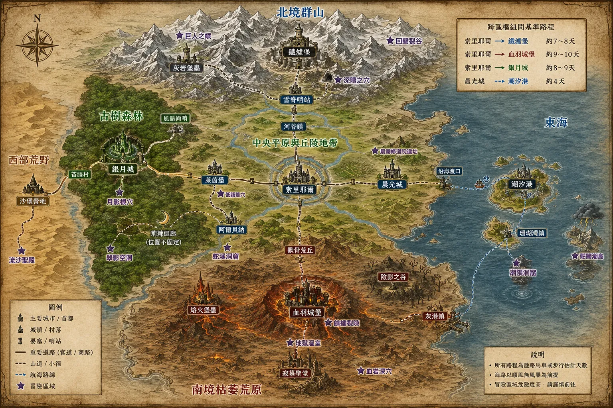

# ElondiaRPG — 埃隆迪亞大陸

以 UI 操作數值、行動與戰鬥的奇幻 RPG 網頁遊戲。每次行動、事件或戰鬥結束後，遊戲引擎輸出一份結構化報告，再交給 AI 寫成事件的詳細經過。



## 執行

需要 Node.js 22.18 以上、Git 與 [pnpm](https://pnpm.io/)。

```bash
git clone -b claude/admiring-tesla-zzw8ii https://github.com/yellow630914/ElondiaRPG.git
cd ElondiaRPG
pnpm install
pnpm dev               # 開發伺服器
pnpm test:unit --run   # 測試
pnpm build             # 型別檢查 + 建置到 dist/
```

開發伺服器啟動後，用瀏覽器打開終端機顯示的網址（預設 http://localhost:5173）。

畫面分成三欄：左邊是地圖、「👥 隊伍」與「💞 關係」視窗按鈕、主動行動、休息與行動備註；中間是冒險日誌（戰鬥時換成戰鬥畫面）；右邊是目前所在設施的選單、委託與旅行。設定在右上角。AI 提議更新人際關係描述時，右下角會跳出提醒。

**AI 細節描述**可以在「⚙️ 設定」或日誌上方開關：

- 開啟：每次行動、事件或戰鬥結束後，自動請 AI 寫出詳細經過。需要先在「設定」選擇 AI 服務並填入自己的 API key（Anthropic、OpenAI、Google Gemini，或 OpenRouter / DeepSeek / Ollama 等 OpenAI 相容格式）。
- 關閉（預設）：不呼叫 AI，戰鬥直接顯示戰報，其他事件顯示簡述。

**AI 判定主動行動**（「設定」，預設關閉）：開啟時，主動行動擲骰後由 AI 決定結果並寫出經過，酒館候選人、商店的交易清單與談判方式也由 AI 設計；關閉時依規則判定與生成。

> - `pnpm-workspace.yaml` 已經設定好不執行 `@google/genai` 與 `protobufjs` 的安裝腳本（兩者都不需要），所以 `pnpm install` 不會出現 `ERR_PNPM_IGNORED_BUILDS`。
> - 也可以用 npm（`npm install`、`npm run dev`）。`.npmrc` 的 `legacy-peer-deps` 是為了避開 npm 10 在解析 vitest 選用依賴時的錯誤。

## 目前可以做什麼

- 建立角色：6 種族、10 職業、五屬性與自由點數；自選出生地（冒險的起點），自行填寫性別、外貌與背景（會交給 AI 作為描寫主角的依據）
- 走格子：城市與城鎮是固定的格子地圖（可在區塊間移動），近郊荒野與地下城四層是隨機生成、有戰爭迷霧
- 依世界書路程旅行，消耗天數、食宿與乾糧，旅途有天候檢定與事件
- 旅店、神殿、雜貨店、酒館、冒險者公會都是地圖上的設施
- 商店與交易：每間店每天一份交易清單（可由 AI 依商店類型生成），交易內容可以組合金錢、物品、好感度、情報甚至夥伴；一般交易直接計算，想殺價時才檢定
- 談判：委託報酬、打聽門路、長期折扣；選擇談判方式依規則檢定，自己描述做法則交給 AI 判定；結果可以是任務旗標或報酬
- 行囊：使用藥劑、更換裝備
- 夥伴：酒館雇傭（可自訂出價與談判方式）、加入別人的隊伍、奴隸市場（公開與黑市，可殺價）、主角作為奴隸（談判或逃離）、事件入隊與主動邀請；親密度 ≤ -20 的同伴會在休息時離隊；奴隸契約印記有不同的限制與副作用
- D&D 短休（生命骰）與長休（旅店、安全房）
- 主動行動：用文字描述主角要做的事，先擲骰，再把骰值與完整資料（隊伍、屬性、裝備、技能、人際關係、記憶）交給 AI，由 AI 決定成敗（可能出乎預料）並直接寫出經過；數值後果由程式夾在上限內
- 公會委託：F 級在城內與近郊，E 級以上在冒險區域
- 逐回合戰鬥：行動點、法術環、命中對迴避、幸運一擊、13 種傷害屬性加成、10 類 BUFF／DEBUFF，10 個職業共 150 項技能／法術／戲法
- 戰後產生戰報、分配經驗；升級時分配屬性點並三選一學習能力
- 人際關係（親密度、外貌、與主角及他人的關係）與冒險記憶（時間、地點、參與人、簡述），生成文本時依參與人、地點、時間檢索後交給 AI；AI 可以提議更新關係描述，由玩家確認；記憶超過 200 筆時自動合併舊的日常記憶
- AI 細節描述可開關：開啟時自動生成敘事（串流顯示），關閉時顯示戰報與事件簡述；也可以複製提示詞自行使用
- 角色名牌：🐱莉娜🏹（種族、依性別上色的名字、職業）；認識的人只在他平常待的地方出現
- 長休時可以和夥伴或同旅館的旅客互動；升級的能力三選一可以重抽（次數可在設定調整）；事件與委託可能給技能報酬
- 戰鬥中可以使用藥劑等道具；主動行動可以搭配法術或技能（花法術環或使用次數換檢定加值）；委託板每天更新
- 每則日誌顯示 AI 呼叫用掉的 token（輸入／輸出／讀到的快取），日誌上方有本局總計
- 🧩 提示詞頁籤：多個文風條目與其他提示詞（可開關、編輯、排序，選擇套用到敘事或判定）；世界書條目的常駐／觸發狀態、注入順序與編輯（也可以新增條目）；查看主角、隊伍、人際關係與記憶的注入結果；預覽下一次送出的完整提示詞；世界書（SillyTavern 格式）、文風與其他提示詞可以各自匯入匯出。提示詞依「不太變動的在前、常變動的在後」排列，以提高快取命中率
- 存讀檔：多個存檔欄位、快速存檔／讀檔（F8 或 Ctrl+S／F9）、長休與抵達目的地時自動存檔（保留 3 份）、讀檔前自動備份；存檔可以匯出成檔案或匯入，目前進度也一直自動存在瀏覽器

## 文件與資料

| 路徑 | 說明 |
|---|---|
| [`docs/GAME_DESIGN.md`](docs/GAME_DESIGN.md) | 遊戲設計：架構、走格子、旅行、城鎮、AI 敘事管線、待決定事項 |
| [`docs/COMBAT_SYSTEM.md`](docs/COMBAT_SYSTEM.md) | 戰鬥系統：屬性、三資源、命中與迴避、幸運一擊、傷害屬性、BUFF、各職業能力清單 |
| [`docs/QUEST_EVENT_DESIGN.md`](docs/QUEST_EVENT_DESIGN.md) | 任務／事件生成系統與 AI 權責劃分（提案） |
| [`docs/RELATIONSHIP_MEMORY.md`](docs/RELATIONSHIP_MEMORY.md) | 人際關係與共同記憶系統、主動行動（擲骰後由 AI 判定並寫出結果） |
| [`docs/COMPANIONS.md`](docs/COMPANIONS.md) | 報酬模板、新增夥伴的五種方式、離隊規則、奴隸契約印記、短休與長休 |
| [`docs/TRADE.md`](docs/TRADE.md) | 物品目錄、交易清單、價格、交涉與談判 |
| [`docs/NPC_SYSTEM.md`](docs/NPC_SYSTEM.md) | NPC 系統重作方案（名單、標籤、活躍地點、互動、警戒與通緝；設計中） |
| [`docs/PROMPTS.md`](docs/PROMPTS.md) | 發給 AI 的提示詞結構（敘事、判定、生成）、排列順序與快取、提示詞頁籤 |
| [`docs/DUNGEON_DESIGN.md`](docs/DUNGEON_DESIGN.md) | 地下城分層探索（周邊 → 淺層 → 中層 → 深層），含實作狀態 |
| [`docs/WORLD_NOTES.md`](docs/WORLD_NOTES.md) | 世界書與地圖之間的不一致與缺漏 |
| [`schemas/report.schema.json`](schemas/report.schema.json) | 事件報告格式（JSON Schema） |
| [`examples/reports/`](examples/reports/) | 範例報告：戰鬥、旅行 |
| [`data/world/`](data/world/) | 區域、勢力、地點、路線天數、城鎮格子地圖、可招募 NPC、生成 NPC 的素材 |
| [`data/rules/`](data/rules/) | 屬性、職業、戰鬥規則、傷害屬性、狀態、能力、裝備、敵人、經濟、委託、夥伴與休息、奴隸契約、主動行動、物品、商店、談判 |
| [`data/worldbook/elondia.worldbook.json`](data/worldbook/elondia.worldbook.json) | 原始世界書（SillyTavern 格式） |
