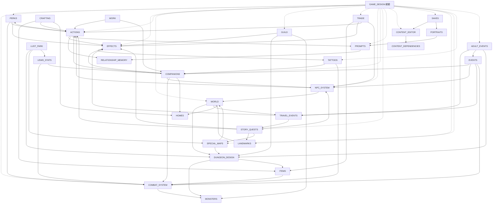

# 文件地圖

> 每份文件開頭都標了「上層／依賴／被依賴」與對應的程式、資料檔。**文件以程式為準**：程式（`src/`）與資料（`data/`）是唯一真相，文件描述的是它們現在的行為；兩份文件說法不同時，回去看程式，不拿一份文件判斷另一份。

## 1. 階層

```
GAME_DESIGN（總綱：原則、遊戲迴圈、報告格式、AI 管線、系統地圖）
│
├─ 基礎規則（被大多數系統依賴）
│   ├─ COMBAT_SYSTEM      屬性、資源、戰鬥、能力、狀態、敵人 AI、戰敗
│   │   └─ MONSTERS       怪物一覽（enemies.json 的整理）
│   ├─ PERKS              特質：一直生效的被動，影響所有檢定與戰鬥
│   ├─ EFFECTS            效果：事件、委託、交易、主動行動共用的後果模板
│   └─ ACTIONS            主動行動：擲骰 → AI 判定 → 程式夾住後果
│
├─ 世界與移動
│   └─ WORLD              地點、路線、聚落、走格子
│       ├─ DUNGEON_DESIGN 地下城分層、光線、安全房、撤退
│       ├─ TRAVEL_EVENTS  旅途地圖、旅途事件、臨時地圖、情報
│       ├─ LANDMARKS      城鎮的特色地標：開放條件、探索、工作與訓練
│       ├─ SPECIAL_MAPS   特殊地圖：下水道、宮殿內部這類人工設計的地方
│       └─ HOMES          空地、房屋、家具、種植
│
├─ 城鎮與經濟
│   ├─ GUILD              一般委託、公會階級與晉升
│   ├─ TRADE              商店、價格、交涉、談判
│   ├─ ITEMS              物品與裝備目錄
│   ├─ CRAFTING           工藝、委託打造、配方、自創配方
│   └─ WORK               工作、娼館、成人向換詞
│
├─ 人物與關係
│   ├─ NPC_SYSTEM         名單、活躍地點、互動、警戒與通緝
│   ├─ COMPANIONS         夥伴、休息、奴隸契約、主人的家
│   ├─ TATTOOS            刺青：奴隸印記、誓約印記、普通刺青
│   └─ RELATIONSHIP_MEMORY 人際關係、共同記憶
│
├─ 劇情與事件
│   ├─ STORY_QUESTS       特殊任務、劇情旗標
│   ├─ EVENTS             事件視窗（要玩家回應的事件）
│   ├─ ADULT_EVENTS       成人向：地下城的色情事件、寄生物
│   ├─ LEWD_STATS         成人向：慾望指標、慾望流派、雙面效應與鎖、主人是工具人
│   └─ LUST_PARK          成人向：魅魔的遊樂園（主題地下城）
│
├─ AI 與呈現
│   ├─ PROMPTS            AI 服務、AI 開關、提示詞結構、快取、世界書注入
│   ├─ PORTRAITS          角色形象插圖
│   ├─ I18N               介面語言與提示詞的繁簡轉換
│   └─ BACKGROUNDS        背景圖
│
├─ 內容與存檔
│   ├─ CONTENT_EDITOR     自訂內容與世界
│   │   └─ CONTENT_DEPENDENCIES 內容之間的引用、刪除與改名的保護
│   └─ SAVES              存檔位置、匯出匯入、存檔格式版本
│
└─ plan/（計畫與追蹤：還沒做完的事）
    ├─ README             放在哪裡、流程、完成紀錄
    ├─ BUGS               Bug：程式沒有照規則運作
    ├─ LOGIC_ISSUES       業務邏輯問題：程式照設計運作，但規則不合理
    ├─ ROADMAP            未來計畫：已經決定要做的事（含程式整理）
    ├─ ideas/             點子庫：還沒決定要不要做的構想，依來源分成不同文件（早期設計、盤點、玩家回饋、開發討論）
    ├─ UI_V2_PLAN         UI 改版的分階段計畫（樣稿在 mockups/，立繪規格在 comfy/）
    └─ LUST_COMBAT_PLAN   慾望戰鬥（成人向）的分階段計畫
```

## 2. 依賴關係

箭頭 A → B 表示「A 的規則用到 B」。



**樞紐**：`EFFECTS`、`ACTIONS` 與 `PERKS`（所有檢定都經過 `checkModifiers`）被最多系統依賴，改它們的格式或上限時，要一起看 GUILD、TRADE、COMPANIONS、STORY_QUESTS、WORK、CRAFTING、NPC_SYSTEM。

## 3. 文件一覽

| 文件 | 內容 | 主要程式 |
|---|---|---|
| [GAME_DESIGN](GAME_DESIGN.md) | 總綱 | — |
| [COMBAT_SYSTEM](COMBAT_SYSTEM.md) | 戰鬥與角色數值；第 9 節是各職業能力清單 | `character.ts`、`combat.ts`、`defeat.ts` |
| [MONSTERS](MONSTERS.md) | 怪物一覽（資料整理） | `data/rules/enemies.json` |
| [PERKS](PERKS.md) | 特質（被動） | `perks.ts`、`perkActions.ts` |
| [EFFECTS](EFFECTS.md) | 效果種類 | `effects.ts` |
| [ACTIONS](ACTIONS.md) | 主動行動 | `actions.ts`、`checks.ts`、`narrator/judge.ts` |
| [WORLD](WORLD.md) | 地點、聚落、走格子 | `world.ts`、`grid.ts` |
| [DUNGEON_DESIGN](DUNGEON_DESIGN.md) | 地下城 | `grid.ts`、`light.ts`、`expedition.ts` |
| [TRAVEL_EVENTS](TRAVEL_EVENTS.md) | 旅途 | `road.ts`、`travel.ts`、`intel.ts` |
| [HOMES](HOMES.md) | 房屋 | `homes.ts`、`garden.ts` |
| [GUILD](GUILD.md) | 公會 | `town.ts`、`materialQuests.ts`、`guild.ts` |
| [TRADE](TRADE.md) | 交易 | `trade.ts`、`negotiation.ts` |
| [ITEMS](ITEMS.md) | 物品與裝備（資料整理） | `gear.ts`、`inventory.ts`、`tools.ts` |
| [CRAFTING](CRAFTING.md) | 工藝 | `crafting.ts`、`craft.ts`、`recipes.ts`、`invention.ts` |
| [WORK](WORK.md) | 工作與娼館 | `work.ts`、`brothel.ts` |
| [NPC_SYSTEM](NPC_SYSTEM.md) | NPC | `population.ts`、`interactions.ts`、`encounters.ts`、`security.ts` |
| [TATTOOS](TATTOOS.md) | 刺青（奴隸印記、誓約印記、普通刺青） | `tattoos.ts` |
| [LANDMARKS](LANDMARKS.md) | 城鎮的特色地標 | `landmarks.ts`、`landmarkMods.ts` |
| [SPECIAL_MAPS](SPECIAL_MAPS.md) | 特殊地圖（下水道之類人工設計的地方） | `specialMaps.ts`、`specialMapMods.ts` |
| [COMPANIONS](COMPANIONS.md) | 夥伴與奴隸 | `companions.ts`、`party.ts`、`rest.ts`、`slavery.ts`、`masterHome.ts` |
| [RELATIONSHIP_MEMORY](RELATIONSHIP_MEMORY.md) | 關係與記憶 | `social.ts` |
| [STORY_QUESTS](STORY_QUESTS.md) | 特殊任務 | `story.ts`、`storyFlags.ts`、`storyMods.ts` |
| [EVENTS](EVENTS.md) | 事件視窗 | `components/events/` |
| [PROMPTS](PROMPTS.md) | 提示詞 | `narrator/` |
| [PORTRAITS](PORTRAITS.md) | 插圖 | `narrator/imageInfo.ts`、`imageProviders.ts`、`comfy.ts` |
| [I18N](I18N.md) | 介面語言、提示詞的繁簡轉換 | `i18n/uiScript.ts`、`narrator/script.ts`、`script.ts` |
| [BACKGROUNDS](BACKGROUNDS.md) | 背景圖 | `components/fx/backgrounds.ts`、`BackgroundLayer.vue` |
| [CONTENT_EDITOR](CONTENT_EDITOR.md) | 自訂內容 | `mods.ts`、`stores/content.ts` |
| [CONTENT_DEPENDENCIES](CONTENT_DEPENDENCIES.md) | 內容引用與保護 | `usage.ts`、`mods.ts` |
| [SAVES](SAVES.md) | 存檔 | `stores/saves.ts`、`stores/game.ts`、`state.ts` |
| [ADULT_EVENTS](ADULT_EVENTS.md) | 地下城的色情事件、寄生物（成人向） | `dungeonEvents.ts`、`parasites.ts`、`parasiteEvents.ts` |
| [LEWD_STATS](LEWD_STATS.md) | 慾望指標、流派、雙面效應（成人向） | `lewd.ts`、`schools.ts`、`masterTool.ts` |
| [LUST_PARK](LUST_PARK.md) | 魅魔的遊樂園：主題地下城（成人向） | `park.ts` |
| [plan/README](plan/README.md) | 計畫與追蹤：分類、流程、完成紀錄 | — |
| [plan/BUGS](plan/BUGS.md) | Bug | — |
| [plan/LOGIC_ISSUES](plan/LOGIC_ISSUES.md) | 業務邏輯問題 | — |
| [plan/ROADMAP](plan/ROADMAP.md) | 未來計畫 | — |
| [plan/ideas/](plan/ideas/README.md) | 點子庫（依來源分開） | — |
| [plan/UI_V2_PLAN](plan/UI_V2_PLAN.md) | UI 改版計畫 | `components/` |
| [plan/LUST_COMBAT_PLAN](plan/LUST_COMBAT_PLAN.md) | 慾望戰鬥（成人向）的實作計畫 | `engine/combat.ts` 等 |

沒有標資料夾的程式檔都在 `src/engine/`。

## 4. 其他文件

| 位置 | 內容 |
|---|---|
| [`../README.md`](../README.md) | 專案說明：怎麼玩、遊戲內容、自己建置、發布新版本 |
| [`../CHANGELOG.md`](../CHANGELOG.md) | 版本更新紀錄（新的改動先寫在「未發布」） |
| [`guide/`](guide/README.md) | **遊戲攻略**（給玩家）：特殊任務、事件、物品與裝備的取得方式、固定 NPC 在哪裡、地標。由 `worldgen/tools/guide/guide.py` 依 `data/` 自動產生，不要手改；改了資料後重跑（測試 `guide.spec.ts` 會檢查是不是最新的） |
| [`../worldgen/`](../worldgen/README.md) | 世界製作：給 Agent 或玩家的世界生成指南、各種內容的製作指南（`guides/`）、設計方法（`design/`）、平衡性自檢（`balance/`）、世界模板（`templates/`）、內建內容的產生腳本（`scripts/elondia/`） |
| [`comfy/portrait-spec.md`](comfy/portrait-spec.md) | 模組化像素立繪規格（ComfyUI） |
| [`mockups/`](mockups/) | UI 樣稿（HTML） |
| [`../tools/pixel/`](../tools/pixel/README.md) | 像素素材管線 |
| `../tools/portraits/finalize.py` | 固定 NPC 的內建形象圖：把遊戲匯出的形象圖轉成 `src/assets/portraits/<npc id>.webp`（說明見 [PORTRAITS](PORTRAITS.md)） |
| [`../src/assets/backgrounds/`](../src/assets/backgrounds/README.md)、[`../src/assets/scenes/`](../src/assets/scenes/README.md) | 背景圖、建築場景圖的檔名規則 |

## 5. GitHub Wiki

[Wiki](https://github.com/yellow630914/ElondiaRPG/wiki) 由這些文件自動產生，不在 wiki 上直接寫：

- 哪份文件變成哪一頁、放在側邊欄的哪一組（玩家指南、遊戲攻略、遊戲系統、世界製作、開發、計畫與追蹤），寫在 [`tools/wiki/build.mjs`](../tools/wiki/build.mjs) 的 `GROUPS`。文件之間的連結會改成 wiki 頁面的連結（用代號當連結文字的，例如 `[COMBAT_SYSTEM](COMBAT_SYSTEM.md)`，會顯示成頁名「戰鬥系統」），其他連結改成 GitHub 上那個版本的檔案。
- 推送版本 tag、發布流程（`release.yml`）成功之後，[`.github/workflows/wiki.yml`](../.github/workflows/wiki.yml) 產生那一版的頁面並推到 wiki（發布失敗時不更新）；也可以在 Actions → Wiki → Run workflow 手動同步。第一次使用前要先在 GitHub 的 Wiki 頁籤按「Create the first page」建立 wiki（隨便存一頁，同步時會被覆蓋）。
- 本機預覽：`node tools/wiki/build.mjs --out wiki-out`（`wiki-out/` 不進 git）。
- **新增文件時要加進 `GROUPS`**（不放上 wiki 的加進 `SKIP`），否則測試 `src/__tests__/wiki.spec.ts` 會失敗。

## 6. 維護規則

1. **以程式為準。** 改了程式就改文件；發現文件和程式不同，照程式改文件（程式本身有問題時，沒照規則跑的記到 [plan/BUGS](plan/BUGS.md)，規則不合理的記到 [plan/LOGIC_ISSUES](plan/LOGIC_ISSUES.md)）。
2. **一件事只寫在一個地方。** 其他文件只放連結。例如效果種類只寫在 EFFECTS、主動行動的流程只寫在 ACTIONS、價格公式只寫在 TRADE 第 3 節、休息規則只寫在 COMPANIONS 第 5 節。
3. **還沒做完的事寫進 [plan/](plan/README.md)**（Bug、業務邏輯問題、未來計畫、點子庫分開），不要散在各文件末尾；處理完把結論寫回系統文件，再從清單刪掉，在 plan/README 記一行完成紀錄。
4. **新增系統時**：開一份文件，開頭寫「上層／依賴／被依賴」與程式、資料檔，再把它加進本文件的階層、依賴圖與一覽表，以及 wiki 的 `GROUPS`（第 5 節）。
5. **不要改檔名。** 程式註解與 `data/` 的 `$comment` 會用「docs/檔名.md 第 N 節」引用文件；改章節編號時要一起搜尋 `docs/檔名` 更新。
6. **資料整理型的表格**（MONSTERS 的怪物表、ITEMS 的制式裝備與消耗品、卷軸、書籍表、COMBAT_SYSTEM 第 9 節）由 `npm run docs:gen` 產生，改了資料要重跑（`docTables.spec.ts` 會檢查）；ITEMS 其他的表格手寫，改資料時要記得同步。 `guide/`（遊戲攻略）也是產生的，改資料後重跑 `python3 worldgen/tools/guide/guide.py`（`guide.spec.ts` 會檢查）。
