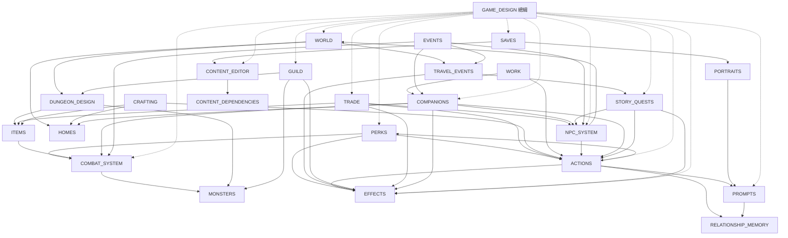

# 文件地圖

> 每份文件開頭都標了「上層／依賴／被依賴」與對應的程式、資料檔。**文件以程式為準**：程式（`src/`）與資料（`data/`）是唯一真相，文件描述的是它們現在的行為；兩份文件說法不同時，回去看程式，不拿一份文件判斷另一份。

## 1. 階層

```
GAME_DESIGN（總綱：原則、遊戲迴圈、報告格式、AI 管線、系統地圖）
│
├─ 基礎規則（被大多數系統依賴）
│   ├─ COMBAT_SYSTEM      屬性、資源、戰鬥、能力、狀態、敵人 AI、戰敗
│   │   └─ MONSTERS       怪物一覽（enemies.json 的整理）
│   ├─ PERKS              特質：一直生效的被動，影響所有檢定與戰鬥
│   ├─ EFFECTS            效果：事件、委託、交易、主動行動共用的後果模板
│   └─ ACTIONS            主動行動：擲骰 → AI 判定 → 程式夾住後果
│
├─ 世界與移動
│   └─ WORLD              地點、路線、聚落、走格子
│       ├─ DUNGEON_DESIGN 地下城四層、光線、安全房、撤退
│       ├─ TRAVEL_EVENTS  旅途地圖、旅途事件、臨時地圖、情報
│       └─ HOMES          空地、房屋、家具、種植
│
├─ 城鎮與經濟
│   ├─ GUILD              一般委託、公會階級與晉升
│   ├─ TRADE              商店、價格、交涉、談判
│   ├─ ITEMS              物品與裝備目錄
│   ├─ CRAFTING           工藝、委託打造、配方、自創配方
│   └─ WORK               工作、娼館、成人向換詞
│
├─ 人物與關係
│   ├─ NPC_SYSTEM         名單、活躍地點、互動、警戒與通緝
│   ├─ COMPANIONS         夥伴、休息、奴隸契約、主人的家
│   └─ RELATIONSHIP_MEMORY 人際關係、共同記憶
│
├─ 劇情與事件
│   ├─ STORY_QUESTS       特殊任務、劇情旗標
│   └─ EVENTS             事件視窗（要玩家回應的事件）
│
├─ AI 與呈現
│   ├─ PROMPTS            AI 服務、提示詞結構、快取、世界書注入
│   └─ PORTRAITS          角色形象插圖
│
├─ 內容與存檔
│   ├─ CONTENT_EDITOR     自訂內容與世界
│   │   └─ CONTENT_DEPENDENCIES 內容之間的引用、刪除與改名的保護
│   └─ SAVES              存檔位置、匯出匯入、存檔格式版本
│
└─ 追蹤清單
    ├─ OPEN_QUESTIONS     待決定事項（集中在這裡）
    └─ KNOWN_ISSUES       程式中發現的 Bug 與不合理之處
```

## 2. 依賴關係

箭頭 A → B 表示「A 的規則用到 B」。



**樞紐**：`EFFECTS`、`ACTIONS` 與 `PERKS`（所有檢定都經過 `checkModifiers`）被最多系統依賴，改它們的格式或上限時，要一起看 GUILD、TRADE、COMPANIONS、STORY_QUESTS、WORK、CRAFTING、NPC_SYSTEM。

## 3. 文件一覽

| 文件 | 內容 | 主要程式 |
|---|---|---|
| [GAME_DESIGN](GAME_DESIGN.md) | 總綱 | — |
| [COMBAT_SYSTEM](COMBAT_SYSTEM.md) | 戰鬥與角色數值；第 9 節是各職業能力清單 | `character.ts`、`combat.ts`、`defeat.ts` |
| [MONSTERS](MONSTERS.md) | 怪物一覽（資料整理） | `data/rules/enemies.json` |
| [PERKS](PERKS.md) | 特質（被動） | `perks.ts`、`perkActions.ts` |
| [EFFECTS](EFFECTS.md) | 效果種類 | `effects.ts` |
| [ACTIONS](ACTIONS.md) | 主動行動 | `actions.ts`、`checks.ts`、`narrator/judge.ts` |
| [WORLD](WORLD.md) | 地點、聚落、走格子 | `world.ts`、`grid.ts` |
| [DUNGEON_DESIGN](DUNGEON_DESIGN.md) | 地下城 | `grid.ts`、`light.ts`、`expedition.ts` |
| [TRAVEL_EVENTS](TRAVEL_EVENTS.md) | 旅途 | `road.ts`、`travel.ts`、`intel.ts` |
| [HOMES](HOMES.md) | 房屋 | `homes.ts`、`garden.ts` |
| [GUILD](GUILD.md) | 公會 | `town.ts`、`materialQuests.ts`、`guild.ts` |
| [TRADE](TRADE.md) | 交易 | `trade.ts`、`negotiation.ts` |
| [ITEMS](ITEMS.md) | 物品與裝備（資料整理） | `gear.ts`、`inventory.ts`、`tools.ts` |
| [CRAFTING](CRAFTING.md) | 工藝 | `crafting.ts`、`craft.ts`、`recipes.ts`、`invention.ts` |
| [WORK](WORK.md) | 工作與娼館 | `work.ts`、`brothel.ts`、`content.ts` |
| [NPC_SYSTEM](NPC_SYSTEM.md) | NPC | `population.ts`、`interactions.ts`、`encounters.ts`、`security.ts` |
| [TATTOOS](TATTOOS.md) | 刺青（奴隸印記、誓約印記、普通刺青） | `tattoos.ts` |
| [LANDMARKS](LANDMARKS.md) | 城鎮的特色地標 | `landmarks.ts`、`landmarkMods.ts` |
| [SPECIAL_MAPS](SPECIAL_MAPS.md) | 特殊地圖（下水道之類人工設計的地方） | `specialMaps.ts`、`specialMapMods.ts` |
| [COMPANIONS](COMPANIONS.md) | 夥伴與奴隸 | `companions.ts`、`party.ts`、`rest.ts`、`slavery.ts`、`masterHome.ts` |
| [RELATIONSHIP_MEMORY](RELATIONSHIP_MEMORY.md) | 關係與記憶 | `social.ts` |
| [STORY_QUESTS](STORY_QUESTS.md) | 特殊任務 | `story.ts`、`storyFlags.ts`、`storyMods.ts` |
| [EVENTS](EVENTS.md) | 事件視窗 | `components/events/` |
| [PROMPTS](PROMPTS.md) | 提示詞 | `narrator/` |
| [PORTRAITS](PORTRAITS.md) | 插圖 | `narrator/imageInfo.ts`、`imageProviders.ts`、`comfy.ts` |
| [CONTENT_EDITOR](CONTENT_EDITOR.md) | 自訂內容 | `mods.ts`、`stores/content.ts` |
| [CONTENT_DEPENDENCIES](CONTENT_DEPENDENCIES.md) | 內容引用與保護 | `usage.ts`、`mods.ts` |
| [SAVES](SAVES.md) | 存檔 | `stores/saves.ts`、`stores/game.ts`、`state.ts` |
| [OPEN_QUESTIONS](OPEN_QUESTIONS.md) | 待決定事項 | — |
| [KNOWN_ISSUES](KNOWN_ISSUES.md) | 程式問題 | — |

沒有標資料夾的程式檔都在 `src/engine/`。

## 4. 維護規則

1. **以程式為準。** 改了程式就改文件；發現文件和程式不同，照程式改文件（程式本身有問題時記到 KNOWN_ISSUES）。
2. **一件事只寫在一個地方。** 其他文件只放連結。例如效果種類只寫在 EFFECTS、主動行動的流程只寫在 ACTIONS、價格公式只寫在 TRADE 第 3 節、休息規則只寫在 COMPANIONS 第 5 節。
3. **待決定的事寫進 OPEN_QUESTIONS**，不要散在各文件末尾；決定之後把結論寫回系統文件，再從清單刪掉。
4. **新增系統時**：開一份文件，開頭寫「上層／依賴／被依賴」與程式、資料檔，再把它加進本文件的階層、依賴圖與一覽表。
5. **不要改檔名。** 程式註解與 `data/` 的 `$comment` 會用「docs/檔名.md 第 N 節」引用文件；改章節編號時要一起搜尋 `docs/檔名` 更新。
6. **資料整理型的表格**（MONSTERS、ITEMS、COMBAT_SYSTEM 第 9 節）沒有產生腳本，改資料時要記得同步。
